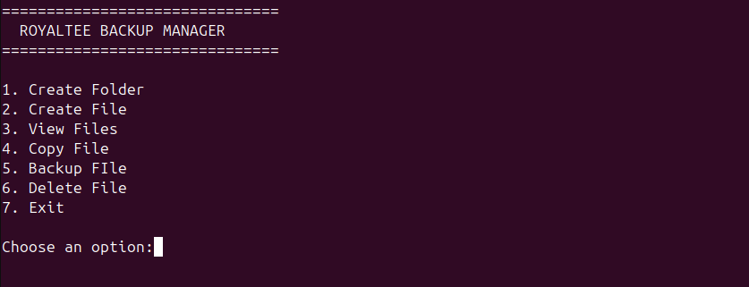
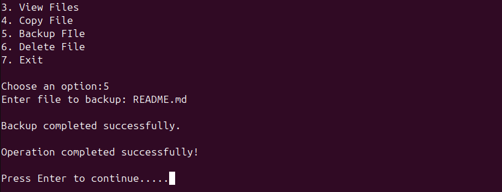
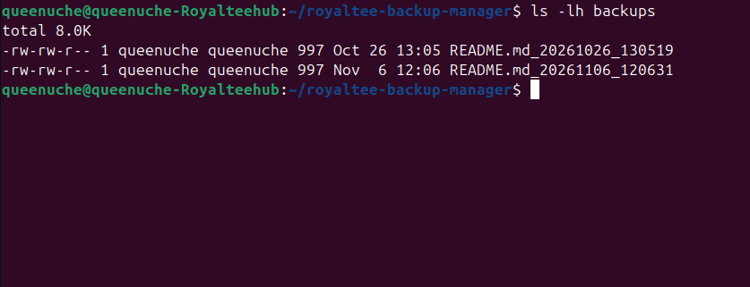

# ROYALTEE Backup Manager

A menu-driven Bash script for practising Linux file management and basic backup operations.

## Features

- Create directories.
- Create files.
- List files in the current directory.
- Copy files.
- Back up existing files using timestamps.
- Delete files.
- Navigate an interactive menu.

## Technologies

- Linux
- Bash scripting
- Git
- GitHub

## Requirements

- A Linux environment with Bash installed.

## How to Run

Clone or download this repository, navigate into the project directory, and run:

```bash
chmod +x backup_manager.sh
./backup_manager.sh
```

## Usage

Select an option from the interactive menu and follow the prompts.

The backup feature stores timestamped copies in a `backups` directory.

## Learning Objectives

This project demonstrates practical use of:

- Bash functions
- Loops and `case` statements
- Conditional statements
- File and directory management
- Command substitution
- Timestamps
- Basic error handling

## Author

Queen Uche

## Screenshots

### Application Menu


### Successful Backup


### Timestamped Backup Files

